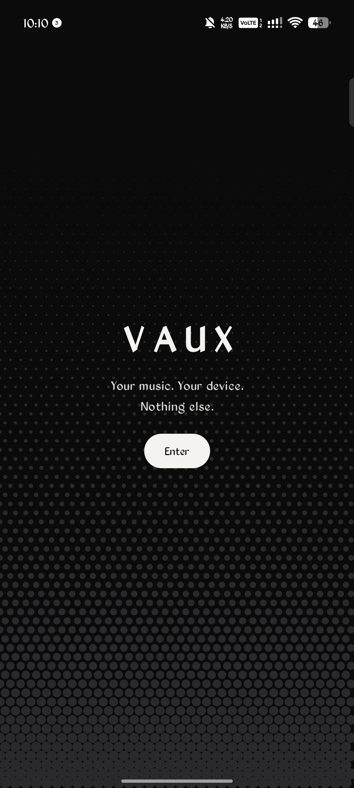
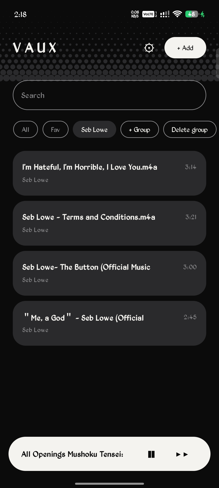
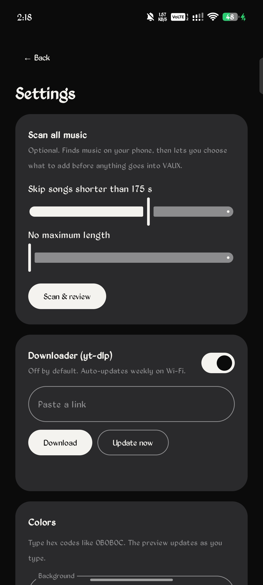

# V A U X

**A private, offline music player with ink-and-paper manga styling.**
No accounts. No ads. No servers. Just the music you choose.

**[⬇ Download the latest APK](https://github.com/vaujx/VAUX/releases/latest)**

---

## Screenshots

| First launch | Your songs | Settings |
|:---:|:---:|:---:|
|  |  |  |

## Why VAUX

Most music apps want your account, your data, and your attention. VAUX only has the songs **you** put in it, works fully offline, and stays out of the way: it does nothing in the background unless music is playing.

The look comes from manga: solid ink black, warm paper white, and screentone halftone dots, wrapped in rounded, modern shapes.

## Features

- **You choose your music.** Pick songs individually from your phone. Nothing is added automatically.
- **Optional smart scan.** Scan your phone, set a minimum and maximum song length to skip voice notes and long mixes, then **review the results and tick only what you want** before anything is added. You can send them straight into a group.
- **Groups.** Organise songs into your own groups. Deleting a group never deletes your songs.
- **Multi-select.** Long-press to select many songs, then add them to a group, edit them, or remove them in one go.
- **Fix song info.** Edit a song's title and artist, or set the artist for many songs at once. Your files are never modified.
- **Full player.** Seek bar, shuffle, repeat (all / one / off), next / previous, a mini player, and a lock-screen notification.
- **Custom colours.** Change the app's colours with hex codes, with a live preview before you apply.
- **Safety confirmations.** Destructive actions need you to type `VAUX` first.
- **Katana intro.** A short multi-slash animation on launch (tap to skip).
- **Light on your phone.** Playback runs only while music plays. No analytics, no ads, no background syncing.
- **Optional downloader.** Off by default. See [Downloader](#downloader-optional) below.

## Install

1. Go to the [**Releases**](https://github.com/vaujx/VAUX/releases/latest) page and download `VAUX-release.apk`.
2. Open the file on your phone. If asked, allow **Install from unknown sources** for your browser or file manager.
3. Open **VAUX**, tap **Enter**, and use **+ Add** to choose your songs.

**Requirements:** Android 8.0 or newer, 64-bit ARM phone (nearly all phones from the last several years). The APK is large (roughly 80-100 MB) because it includes the optional downloader's components.

> VAUX is not on the Google Play Store.

## How to use

| I want to... | Do this |
|---|---|
| Add songs | Tap **+ Add**, tick one or many files |
| Find all music on my phone | **Settings → Scan & review**, tick what you want, optionally pick a group |
| Skip very short or very long tracks | **Settings** length sliders (used by the scan) |
| Select several songs | Long-press one, then tap others |
| Fix a title or artist | Select the song, tap **Edit** (select many to set one artist for all) |
| Make a group | Tap **+ Group** |
| Delete a group | Open it, tap **Delete group**, type `VAUX` |
| Change the colours | **Settings → Colors**, type hex codes, check the preview, **Apply** |

## Downloader (optional)

VAUX can optionally fetch audio from links using [yt-dlp](https://github.com/yt-dlp/yt-dlp). It is **off by default**; turning it on shows a notice you must accept. When on, it checks for yt-dlp updates once a week, on Wi-Fi only.

**You are solely responsible** for what you download. Only download content you have the right to keep, and follow copyright law and the terms of the sites you use. VAUX is not affiliated with, endorsed by, or sponsored by YouTube, Google, or the yt-dlp project.

## Tech stack

| Area | Technology |
|---|---|
| Language | Kotlin 2.0 |
| UI | Jetpack Compose, Material 3, custom canvas drawing (halftone texture, katana animation) |
| Audio | AndroidX Media3 (ExoPlayer + MediaSession service) |
| Storage | Room (SQLite) via KSP, Storage Access Framework, MediaStore |
| Background work | WorkManager (a single weekly, Wi-Fi-only job, only if the downloader is on) |
| Startup | AndroidX Core SplashScreen |
| Downloader | youtubedl-android (bundles yt-dlp, Python, and FFmpeg) |
| Build | Gradle 8.10, Android Gradle Plugin 8.7, JDK 17 |
| Tooling | Built entirely from the command line with a batch script, no Android Studio |
| Target | `minSdk 26`, `targetSdk 35`, `arm64-v8a` |

## Privacy

VAUX has no accounts, analytics, ads, or servers. Your library lives only on your device. The only network use is the optional downloader and its weekly update check.

## Third-party components

| Component | License |
|---|---|
| AndroidX / Jetpack Compose / Media3 / Room / WorkManager | Apache-2.0 |
| Kotlin | Apache-2.0 |
| [youtubedl-android](https://github.com/yausername/youtubedl-android) | GPL-3.0 |
| [yt-dlp](https://github.com/yt-dlp/yt-dlp) | Unlicense |
| FFmpeg | LGPL / GPL (depends on the build, see upstream) |

## Build from source

You do not need Android Studio.

1. Install **JDK 17** ([adoptium.net](https://adoptium.net)).
2. Clone this repo and double-click `build.bat` (or run it from Command Prompt):
   - `build.bat` builds a debug APK into `dist\`
   - `build.bat release` builds a signed release APK (it creates your own signing key on first run)
   - `build.bat install` installs to a USB-connected phone
3. The first run downloads the Android SDK tools and Gradle, so it takes a while.

To use your own icon, save a square transparent PNG as `icon/icon.png` before building.

## License

VAUX is free software, released under the **GNU General Public License v3.0**. See [`LICENSE`](LICENSE). Anyone may use, study, modify, and share it under those terms, and modified versions must stay open under the same license.

The VAUX name and the logo/icon artwork are not covered by that license, so please do not use them to present your own version as the original. See [`LEGAL.md`](LEGAL.md) for the full notice.

## Disclaimer

VAUX is provided **"as is", without warranty of any kind**. The author is not liable for any damage, loss, or legal issue arising from its use, or from how anyone uses the optional downloader.

## Contact

Found a bug or have an idea? Open an [issue](https://github.com/vaujx/VAUX/issues).
